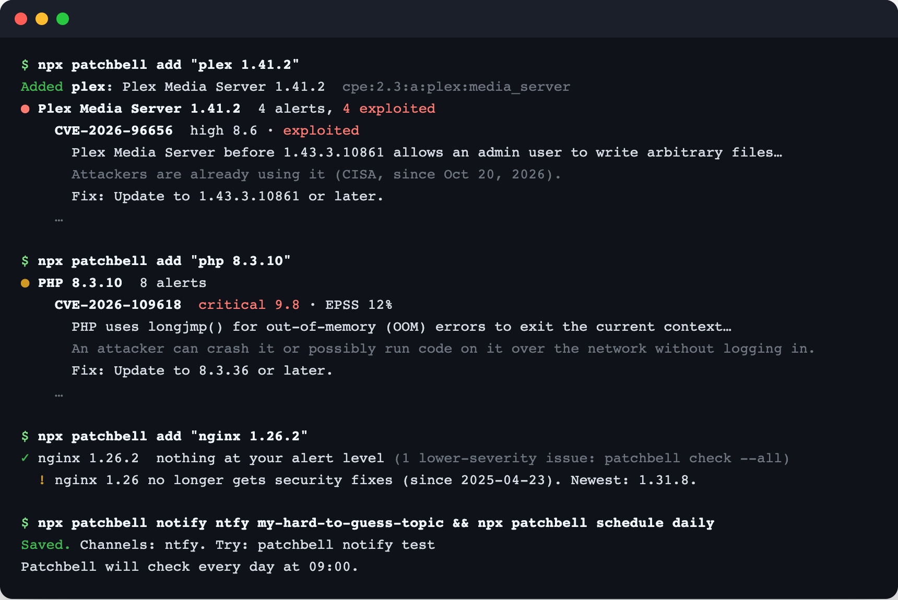
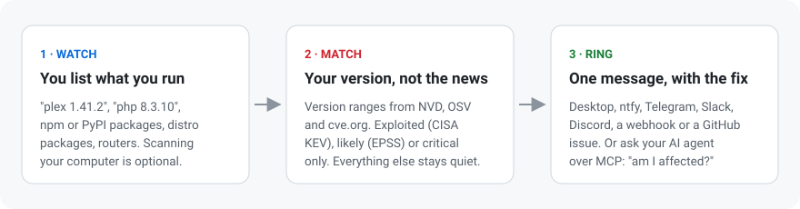

# Patchbell

**Get told when software you run has a serious vulnerability, and only then.**

Tell Patchbell what you run: `plex 1.41.2`, `php 8.3.10`, `npm:express@4.21.2`, your NAS, your router. Every day it checks those exact versions against NVD, OSV, cve.org, CISA's list of actively exploited vulnerabilities and EPSS, and sends you one message per product when something is exploited, critical or likely to be attacked, with the version that fixes it. No account, no server, nothing to install beyond `npx`.

[](https://www.npmjs.com/package/patchbell) [](https://github.com/kemal-arslan/patchbell/actions/workflows/ci.yml) [](LICENSE) [](https://buymeacoffee.com/kemalarslan)



## Why

AI-assisted bug hunting has roughly doubled the number of new CVEs each month in 2026, and some days bring over 1,900. Yet fewer than 1 in 400 are ever exploited. Following the news means drowning in alerts about software you don't run, versions you don't have and bugs nobody attacks. Patchbell flips it around: it starts from what you run and stays quiet unless your version is affected and the issue is serious.

## Quick start

Requires Node.js 20+.

```bash
npx patchbell add "plex 1.41.2"        # checks it right away
npx patchbell add "php 8.3.10"
npx patchbell add npm:express@4.21.2

npx patchbell notify ntfy my-hard-to-guess-topic   # push to your phone with the ntfy app
npx patchbell schedule daily                       # check every morning at 09:00
```

After you upgrade, tell it: `npx patchbell set plex 1.43.3.10861`.

## How it works



1. **Watch.** Items are names (`plex`, `Home Assistant`, `nginx`), packages (`npm:`, `pypi:`, `go:`, `maven:`, `cargo:`, `gem:`, `composer:`, `nuget:`), distro packages (`osv:Debian:12/openssl@…`) or exact NVD products (`cpe:2.3:a:f5:nginx`). About 330 products are known by name, from [endoflife.date](https://endoflife.date) plus home-lab favourites. Anything else is looked up in NVD's product dictionary, and if a name could mean several products you pick one.
2. **Match.** For your exact version, Patchbell reads the affected-version ranges in NVD. For CVEs from the last 30 days that NVD hasn't analysed yet, it reads the reporter's own record on cve.org, so brand-new issues show up before NVD catches up. Packages are matched by [OSV](https://osv.dev), which also knows distro backports.
3. **Filter.** Each finding is enriched with [CISA KEV](https://www.cisa.gov/known-exploited-vulnerabilities-catalog) (attackers are using it) and [EPSS](https://www.first.org/epss/) (chance of attacks in the next 30 days), then kept only if it meets your level. You're told about each issue once, and again only if it gets worse: when it starts being exploited, or when an unconfirmed match is confirmed for your version.
4. **Ring.** One message per product, most urgent first, with a plain-language reason and the fix. Patchbell also says when your release line stops getting security fixes (`nginx 1.26 no longer gets security fixes`), and, if you ask with `--updates`, when a new release is out.

### Alert levels

| Level | You hear about |
| --- | --- |
| `exploited` | Only issues attackers are already using (CISA KEV) |
| `critical` (default) | Exploited, or CVSS 9.0+, or EPSS 10%+ |
| `high` | Exploited, or CVSS 7.0+, or EPSS 5%+ |
| `all` | Everything that affects your version |

Set the default with `patchbell level high`, or per item: `patchbell add "plex 1.41.2" --level exploited`.

## Notifications

```bash
patchbell notify desktop on                              # macOS and Linux
patchbell notify ntfy <topic> [--server URL] [--token T] # ntfy.sh or your own server
patchbell notify telegram <bot-token> <chat-id>
patchbell notify slack <webhook-url>
patchbell notify discord <webhook-url>
patchbell notify webhook <url>                           # JSON: title, body, url, priority
patchbell notify test

patchbell schedule daily --at 08:30                      # launchd on macOS, a systemd user timer on Linux
patchbell schedule status
patchbell schedule off
```

Ten CVEs in one product are one notification, not ten. Scheduled runs (`check --quiet`) print only when there's something to say; the log is in `~/.patchbell/logs/check.log`.

## Ask your AI agent

Patchbell is also an MCP server, so Claude, Codex or Cursor can keep your watchlist and answer questions about it.

```bash
claude mcp add patchbell -- npx -y patchbell mcp
npx patchbell setup     # config for Codex, Cursor, Claude Desktop and others
```

Then ask: *"I run Plex 1.41.2 and PHP 8.3.10 on my home server, keep an eye on them"*, *"anything new for my stuff this week?"*, or *"am I affected by CVE-2026-109618?"*

| Tool | What it does |
| --- | --- |
| `add_to_watchlist` | Follow something; returns candidates when a name is ambiguous |
| `update_watchlist_item` | Set the new version after an upgrade, or change the level |
| `remove_from_watchlist`, `list_watchlist` | Manage the list |
| `check_now` | Current alerts (doesn't send notifications) |
| `whats_new` | Issues published or newly exploited in the last N days |
| `am_i_affected` | One CVE against every item: affected, not affected or unknown |
| `suggest_from_computer` | Only with `mcp --allow-scan`: installed software you could follow |

## GitHub Action: alerts as issues

Keep the watchlist in a repository and get one issue per vulnerability. Issues are deduplicated; closing one dismisses it, and it's reopened only if attackers start using it.

```bash
npx patchbell export --out patchbell.yml   # your local list, fully resolved
```

```yaml
# .github/workflows/patchbell.yml
name: Patchbell
on:
  schedule:
    - cron: '17 7 * * *'
  workflow_dispatch:
permissions:
  contents: read
  issues: write
jobs:
  check:
    runs-on: ubuntu-latest
    steps:
      - uses: actions/checkout@3d3c42e5aac5ba805825da76410c181273ba90b1 # v7.0.1
      - uses: kemal-arslan/patchbell@v0
        with:
          watchlist: patchbell.yml
```

See [examples/patchbell.yml](examples/patchbell.yml) for the file format. In other CI systems, `patchbell check --watchlist patchbell.yml --fail-on-alerts` exits with code 2 when there are alerts.

## Am I affected by this one?

```bash
patchbell cve CVE-2026-109618
```

prints the CVE's severity, whether it's exploited, and a verdict for each item in your watchlist.

## Optional: suggest items from this computer

```bash
patchbell scan
```

Looks at installed apps, Homebrew formulae and casks, runtimes (PHP, Node.js, Python, Java…), global npm packages and, on Debian or Ubuntu, system packages. It lists what it recognizes and you pick what to follow. Nothing is added on its own, and nothing leaves your machine.

## Data and accuracy

Sources: [NVD](https://nvd.nist.gov), [OSV](https://osv.dev), [cve.org](https://www.cve.org), [CISA KEV](https://www.cisa.gov/known-exploited-vulnerabilities-catalog), [FIRST EPSS](https://www.first.org/epss/) and [endoflife.date](https://endoflife.date). Responses are cached in `~/.patchbell/cache`; after the first check, NVD is only asked for what changed.

- Without an API key NVD allows 5 requests per 30 seconds, so the first check of a big product (Chrome has thousands of CVEs) can take a minute. A free [NVD API key](https://nvd.nist.gov/developers/request-an-api-key) in `NVD_API_KEY` makes it much faster.
- Patchbell reports what the records say, and records can be wrong or late. A quiet check means "nothing known", not "safe".
- Tools bundled with an operating system (macOS's `curl` or `ssh`, distro packages) often carry fixes without a new upstream version. For Debian and Ubuntu packages, use `osv:` items (which `scan` does), since OSV knows about backports.
- Products without a version only get alerts about issues from the last 30 days. Set a version for precise answers.

## Privacy

There is no Patchbell server and no account. To check an item, Patchbell sends its product or package name, and for packages the version, to the public sources above. Everything else stays in `~/.patchbell` (override with `PATCHBELL_HOME`); notification tokens are stored with `600` permissions. See [SECURITY.md](SECURITY.md).

## Commands

| Command | What it does |
| --- | --- |
| `patchbell add <what> [--level L] [--updates] [--note text]` | Follow something and check it right away |
| `patchbell list` / `remove <id>` / `set <id> <version>` | Manage the watchlist |
| `patchbell check [ids…] [--all] [--json] [--quiet] [--no-notify]` | Check now and notify about what's new |
| `patchbell cve <CVE-ID>` | Is anything I run affected by this CVE? |
| `patchbell level <level>` | Default alert level |
| `patchbell notify …` / `schedule …` | Channels and daily checks |
| `patchbell scan` | Optional: suggest items from this computer |
| `patchbell mcp [--allow-scan]` / `setup` | MCP server for AI agents |
| `patchbell export [--out file]` | Watchlist file for the GitHub Action |
| `patchbell check --watchlist file [--github-issues] [--fail-on-alerts]` | CI mode |

## Development

```bash
npm install
npm test            # unit tests, plus end-to-end tests that run the CLI and the MCP server
                    # against local stand-ins for NVD, OSV, KEV, EPSS, cve.org, ntfy and GitHub
npm run typecheck
npm run build
npm run catalog     # refresh the product catalog from endoflife.date
npm run dev -- --help
```

## Support

Patchbell is free and open source. If it rang the bell before something bad happened, you can [buy me a coffee](https://buymeacoffee.com/kemalarslan).

## License

[MIT](LICENSE). The product catalog includes data from [endoflife.date](https://github.com/endoflife-date/endoflife.date) (MIT).
